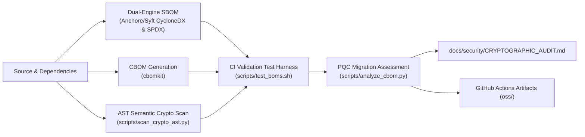

(spire2) ➜  spire-server-private git:(main) ./run.sh --newroot --reset                                         
==========================================
   🚀 Starting SPIRE Demo Runner (v2.12)
   setup_demo.py | add_agent.py
   RESET: enabled
   NEWROOT: enabled
==========================================
--- Found local upstream PKI in /Users/jsoehner/spire-server-private/spire_setup/pki; enabling upstream (auto) ---
--- Generating upstream root+intermediate via pki.sh (force) ---
(pki.sh does not support --subject-root/--subject-int; using legacy --subject)
==> Removing existing Root CA dir (force): /Users/jsoehner/spire-server-private/spire_setup/pki/root-spire-demo
==> Creating Root CA at: /Users/jsoehner/spire-server-private/spire_setup/pki/root-spire-demo
==> Generating Root CA private key (rsa)...
...+....+......+.....+....+..+....+........+............+.+...+..+.........+..........+.........+.....+....+++++++++++++++++++++++++++++++++++++++++++++*....+...+..+...+..........+.....+.+.....+......+....+.....+.+......+..+.............+.....+...+.+...+..+.+++++++++++++++++++++++++++++++++++++++++++++*..+......+.....+.........+....+......+.....+....+...+..+.+.....+...................+..+..........+.......................+...+.......+.....+.......+......+............+.......................+...+.+...+............+.....+.........+....+...+...+..............+.+.........+.....+.......+........+...............+.......+........+.......+......+...+..+.........+.+............+.....+.+.........+...+..+.+......+...+..+.+..................+..+.........+.+........+............+...+..........+......+...+......+.....................+......+.........+......+.................+............+.............+............+.....+.............+......+.....+......+...+.............+...+.........+...+..................+.........+............+...........+.......+........+.......+.....+.+......+...............+.....+...+..........+...+........+.......+..+..................+.......+............+...+....................+.+..............+......+....+...+...+...........+..........+.....+....+..+....+......+..+...+...+.....................+.+..............+..........+..............+......+....+......+...+..+...+...+...+....+...........+.+......+..+.+.................+...+...............+....+...+............+............+...........+...+.....................+...+..................+....+........+......+............+...+....+............+...+......+...............+..+.........+....+...........+.+...+............+........+......+.............+.....+.+..+..................+....+...+..+...+..........+........+.+........+.+.....+.+...........+...+....+..+....+..+...+....+.....+..........+.....................+............+.........+.....+.+............+...........+.+.........+...........+.+..................+..............+...+...+.+...+......+......+...........+...+......+.............+...+........+.......+..+...+.......+.....+................+.....+.......+..+.......+.....+...+..........+.....+......+............+.............+..+.........+...+.+..............+.+......+.....+.+.........+.....+....+......+......+.....+.......+.....................+......+.....+.........+....+............+..............+.+......+........+.........+..........+++++
.........+...+...+.......+..+............+.+..+......+.+....................+....+.........+.....+.+......+...+..+++++++++++++++++++++++++++++++++++++++++++++*....+......................+++++++++++++++++++++++++++++++++++++++++++++*....+......+........................+...........+..........+..............+.+..+..................+.......+..+.+.........+...+..+................+..+....+...+........+...+.+.........+..+.......+..+.............+...........+.........+.......+.....+...+............+...+......+......+...+..........+......+..+............+.......+.....................+..+.......+...+...+.........+..................+............+......+........+......+....+...........+......+.......+......+...........+...+............+......+....+...............+......+........+............+.........+...+.+..+..........+...+............+....................+.........+.+..+......+....+.....................+..+.......+..+...+......+...............+.......+..+..................+...+......+.+..............+.+...............+........................+.........+......+.....+...+.+...........+.+...+.....+.......+........+.....................+...+.......+.....+.........+.........+.+.....+.......+........+++++
==> Generating self-signed Root CA certificate (days=3650)...
==> Root CA created:
 Root key : /Users/jsoehner/spire-server-private/spire_setup/pki/root-spire-demo/private/ca.key.pem
 Root cert: /Users/jsoehner/spire-server-private/spire_setup/pki/root-spire-demo/certs/ca.cert.pem
==> Removing existing Intermediate CA dir (force): /Users/jsoehner/spire-server-private/spire_setup/pki/intermediate-spire-demo
==> Creating Intermediate CA at: /Users/jsoehner/spire-server-private/spire_setup/pki/intermediate-spire-demo
==> Generating Intermediate CA private key (rsa)...
..+.........+..+++++++++++++++++++++++++++++++++++++++++++++*.....+........+....+...+..+....+..+...+....+...+..+...+....+.....+.............+...+..+.+.........+..+...+.+...........+....+.....+.+......+........+....+...........+....+....................+..........+...+..+.+.........+..+...+.+......+......+............+..+.+........+.+......+.....+..........+..+.+..+.......+......+..+....+..............+..........+...........+.+++++++++++++++++++++++++++++++++++++++++++++*....+....+...+.....+.+......+........+.+..+...+......+.+.....+.......+...........+.......+............+...........+.......+.......................+.+..............+.+...+..+...+..................+..........+.................+...+..........+.....+.......+..+.+..+......+......+.+..............+...+.......+......+...+..+..........+............+........+..........+..+......+.+.....+.+..................+.....+............+....+......+.....+.......+.....+.+..+.......+..+....+.....+....+......+..+...+.......+...+......+.........+.........+..+......+..........+.....+...+.......+.....+............+.............+............+..+....+......+......+..+............+..........+...........+.............+..+......................+............+........+......+.+.....+.........+.......+.....+.............+...........+....+...........+...+...............+..........+...+..................+.........+.................+....+...........+...+...+.........+.........................+.....+.+...+.....+.......+............+..+.+........+..........+.........+.................+......+............+...+...+......+...+......+.+......+...+..+...............+....+....................+.+.....+....+.....................+..+.+..+.......+.....+......+......+...+.+......+......+..+..........+..+.+........+......+....+..+....+.........+..+...+.+......+.....+...+....+............+......+.....+....+..................+++++
....+......+...+..........+..+......+....+......+..............+.+.....+++++++++++++++++++++++++++++++++++++++++++++*..+++++++++++++++++++++++++++++++++++++++++++++*....+.+.........+....................+.......+..............+.+..+............+....+.........+.....+......+....+..+...+.+.....+.+......+..+......+.........+............+.+............+......+.........+........+.......+...+.........+.........+.....+.......+.........+........+...+.....................................+..+......+..........+........+.+..............+..........+..+...+....+...+.....+.......+......+.....+....+..+......+...............+....+...........+....+...............+.....+.+..+...+...+....+...+.........+.........+.....+......+.+.....+++++
==> Generating Intermediate CSR...
==> Signing Intermediate certificate with Root CA (non-interactive -batch)...
Using configuration from /Users/jsoehner/spire-server-private/spire_setup/pki/root-spire-demo/openssl.cnf
Check that the request matches the signature
Signature ok
The Subject's Distinguished Name is as follows
countryName           :PRINTABLE:'CA'
stateOrProvinceName   :ASN.1 12:'ON'
localityName          :ASN.1 12:'Scarborough'
organizationName      :ASN.1 12:'Scotiabank'
organizationalUnitName:ASN.1 12:'PKI'
commonName            :ASN.1 12:'bns-demo.test SPIRE Upstream Intermediate CA'
Certificate is to be certified until Feb 12 20:42:13 2031 GMT (1825 days)

Write out database with 1 new entries
Database updated
==> Creating chain.pem (Intermediate + Root)...
==> Intermediate CA created:
 Intermediate key : /Users/jsoehner/spire-server-private/spire_setup/pki/intermediate-spire-demo/private/intermediate.key.pem
 Intermediate cert: /Users/jsoehner/spire-server-private/spire_setup/pki/intermediate-spire-demo/certs/intermediate.cert.pem
 Chain (int+root) : /Users/jsoehner/spire-server-private/spire_setup/pki/intermediate-spire-demo/certs/chain.pem
--- Upstream PKI ready at: /Users/jsoehner/spire-server-private/spire_setup/pki ---
--- Reset requested: wiping compose volumes ---
--- Reset complete ---
Step 1: Running Infrastructure Setup (setup_demo.py)...
🔎 TTL sanity: ca_ttl=60m, default_x509_svid_ttl=300s, trust_domain=bns-demo.test
--- Preparing Directories ---
✅ UpstreamAuthority materials copied into /Users/jsoehner/spire-server-private/spire_setup/upstream (mode=dir)
🔗 UpstreamAuthority: ENABLED
Updated: /Users/jsoehner/spire-server-private/spire_setup/server1/server.conf
Updated: /Users/jsoehner/spire-server-private/spire_setup/server2/server.conf
Updated: /Users/jsoehner/spire-server-private/spire_setup/nginx/nginx.conf
Updated: /Users/jsoehner/spire-server-private/spire_setup/docker-compose.yaml

--- Launching Infrastructure ---
[+] up 35/35
 ✔ Image mirror.gcr.io/chainguard/postgres:latest Pulled                                                                                                                                                                                     18.2s
 ✔ Image ghcr.io/spiffe/spire-server:1.14.1       Pulled                                                                                                                                                                                     11.8s
 ✔ Image mirror.gcr.io/chainguard/nginx:latest    Pulled                                                                                                                                                                                     5.3ss
 ✔ Network spire_setup_spire_demo_net             Created                                                                                                                                                                                    0.0s
 ✔ Volume spire_setup_pgdata                      Created                                                                                                                                                                                    0.0s
 ✔ Container spire_setup-postgres-1               Healthy                                                                                                                                                                                    6.2s
 ✔ Container spire_setup-spire-server-2-1         Created                                                                                                                                                                                    0.1s
 ✔ Container spire_setup-spire-server-1-1         Created                                                                                                                                                                                    0.1s
 ✔ Container spire_setup-load-balancer-1          Created                                                                                                                                                                                    0.0s
✅ Stack launched successfully.
✅ Infrastructure setup complete.
⏳ Waiting 15 seconds for Postgres and SPIRE Server to stabilize...
Step 2: Registering Agent (add_agent.py)...
--- Cleaning Stale Agent Data ---
Removing old agent data: /Users/jsoehner/spire-server-private/spire_setup/persistence/agent
Agent SPIFFE ID: spiffe://bns-demo.test/agent/demo-agent
✅ Agent registration complete.
spire-server-1-1  | time="2026-02-13T20:42:40Z" level=warning msg="Current umask 0022 is too permissive; setting umask 0027"
spire-server-1-1  | time="2026-02-13T20:42:40Z" level=info msg=Configured admin_ids="[]" data_dir=/run/spire launch_log_level=debug version=1.14.1
spire-server-1-1  | time="2026-02-13T20:42:40Z" level=info msg="Opening SQL database" db_type=postgres subsystem_name=sql
spire-server-1-1  | time="2026-02-13T20:42:40Z" level=info msg="Initializing new database" subsystem_name=sql
spire-server-1-1  | time="2026-02-13T20:42:40Z" level=info msg="Connected to SQL database" read_only=false subsystem_name=sql type=postgres version=18.2
spire-server-1-1  | time="2026-02-13T20:42:40Z" level=info msg="Configured DataStore" reconfigurable=false subsystem_name=catalog
spire-server-1-1  | time="2026-02-13T20:42:40Z" level=info msg="Configured plugin" external=false plugin_name=disk plugin_type=KeyManager reconfigurable=false subsystem_name=catalog
spire-server-1-1  | time="2026-02-13T20:42:40Z" level=info msg="Plugin loaded" external=false plugin_name=disk plugin_type=KeyManager subsystem_name=catalog
spire-server-1-1  | time="2026-02-13T20:42:40Z" level=info msg="Configured plugin" external=false plugin_name=join_token plugin_type=NodeAttestor reconfigurable=false subsystem_name=catalog
spire-server-1-1  | time="2026-02-13T20:42:40Z" level=info msg="Plugin loaded" external=false plugin_name=join_token plugin_type=NodeAttestor subsystem_name=catalog
spire-server-1-1  | time="2026-02-13T20:42:40Z" level=info msg="Configured plugin" external=false plugin_name=disk plugin_type=UpstreamAuthority reconfigurable=false subsystem_name=catalog
spire-server-1-1  | time="2026-02-13T20:42:40Z" level=info msg="Plugin loaded" external=false plugin_name=disk plugin_type=UpstreamAuthority subsystem_name=catalog
spire-server-1-1  | time="2026-02-13T20:42:40Z" level=debug msg="Loading journal from datastore" subsystem_name=ca_manager
spire-server-1-1  | time="2026-02-13T20:42:40Z" level=info msg="There is not a CA journal record that matches any of the local X509 authority IDs" subsystem_name=ca_manager
spire-server-1-1  | time="2026-02-13T20:42:40Z" level=info msg="Journal loaded" jwt_keys=0 subsystem_name=ca_manager wit_keys=0 x509_cas=0
spire-server-1-1  | time="2026-02-13T20:42:40Z" level=debug msg="Preparing X509 CA" slot=A subsystem_name=ca_manager
spire-server-1-1  | time="2026-02-13T20:42:40Z" level=debug msg="There is no active X.509 authority yet. Can't save CA journal in the datastore" subsystem_name=ca_manager

---

## 🛡️ Security & Cryptographic Posture

This project tracks Software & Cryptographic Bill of Materials (SBOM & CBOM) and Post-Quantum Cryptography (PQC) readiness. See the latest [Cryptographic Audit & PQC Migration Report](docs/security/CRYPTOGRAPHIC_AUDIT.md).

---

## 🛡️ Automated SBOM & CBOM Supply Chain Pipeline

This repository features an automated continuous supply chain security pipeline defined in [`.github/workflows/sbom-cbom.yml`](.github/workflows/sbom-cbom.yml). On every push, pull request, or tag release, the workflow executes a multi-stage generation, validation, and auditing process:



### CI Pipeline Stages

1. **Dual-Engine SBOM Generation**: Uses `anchore/sbom-action` to produce standard CycloneDX (`oss/sbom.cyclonedx.json`) and SPDX (`oss/sbom.spdx.json`) inventory files.
2. **Cryptographic Bill of Materials (CBOM)**: Uses `cbomkit/cbomkit-action` to discover cryptographic algorithms, certificates, keys, and cryptographic assets (`oss/cbom.json`).
3. **Dual-Engine AST Semantic Crypto Scan**: Executes `scripts/scan_crypto_ast.py` to parse source code abstract syntax trees (ASTs), mapping cryptographic call-sites and cipher initializations to the CBOM inventory.
4. **Automated Verification Harness**: Runs `scripts/test_boms.sh` to validate JSON schemas, verify required CycloneDX attributes, and enforce non-empty inventory thresholds as a build gate.
5. **Post-Quantum Cryptography (PQC) Assessment**: Runs `scripts/analyze_cbom.py` to classify cryptographic assets by quantum-readiness and output markdown summary dashboards to `$GITHUB_STEP_SUMMARY`.
6. **Continuous Governance Publishing**: Automatically syncs the latest cryptographic posture to [`docs/security/CRYPTOGRAPHIC_AUDIT.md`](docs/security/CRYPTOGRAPHIC_AUDIT.md) and publishes all BOM assets to workflow artifacts.

---

## Local Scripts & Verification

All pipeline stages can be executed locally in development environments using scripts in `scripts/`:

### 1. Generating BOMs (`scripts/generate_boms.sh`)

Generate SBOMs and CBOMs for either source directories or Docker container images:

```bash
# Scan current repository directory (outputs to oss/)
bash scripts/generate_boms.sh -t dir .

# Scan a local Docker image
bash scripts/generate_boms.sh -t docker spire-server-private:local

# Specify custom output directory and format
bash scripts/generate_boms.sh -t dir -o build/boms -f cyclonedx-json .
```

### 2. Testing & Validating BOMs (`scripts/test_boms.sh`)

Run automated JSON validation, schema verification, and inventory count checks:

```bash
bash scripts/test_boms.sh oss
```

### 3. Scanning Source AST for Crypto Callsites (`scripts/scan_crypto_ast.py`)

Scan Python and repository source code ASTs for cryptographic primitive invocations and reconcile with an existing CBOM:

```bash
python3 scripts/scan_crypto_ast.py . \
  --cbom oss/cbom.json \
  --output-json oss/crypto-callsites.json
```

### 4. PQC Readiness Analysis (`scripts/analyze_cbom.py`)

Analyze a generated CBOM against software dependencies and generate markdown or JSON risk summaries:

```bash
python3 scripts/analyze_cbom.py oss/cbom.json \
  --sbom oss/sbom.cyclonedx.json \
  --json oss/crypto-analysis.json \
  --markdown docs/security/CRYPTOGRAPHIC_AUDIT.md
```

### 5. OCI Artifact Attachment (`scripts/attach_oci_bom.sh` & `scripts/fetch_oci_cbom.py`)

Publish and retrieve CBOMs attached to OCI container registries:

```bash
# Attach CBOM to container image in registry
bash scripts/attach_oci_bom.sh oss/cbom.json my-registry.io/spire-server-private:v1.0.0

# Fetch CBOM from container image
python3 scripts/fetch_oci_cbom.py my-registry.io/spire-server-private:v1.0.0 --output-dir oss
```

---

## Architectural Decision Records (ADRs)

Key architectural decisions governing this repository's security, supply chain, and cryptography strategy are documented under [`docs/adr/`](docs/adr/):

- [**ADR-0001: Automated SBOM and CBOM Supply Chain Governance Pipeline**](docs/adr/0001-automated-sbom-cbom-supply-chain-governance.md) - Context, alternatives considered, decision rationale, and downstream consequences for adopting automated dual-engine SBOM/CBOM scanning, AST call-site analysis, and CI gate verification.
